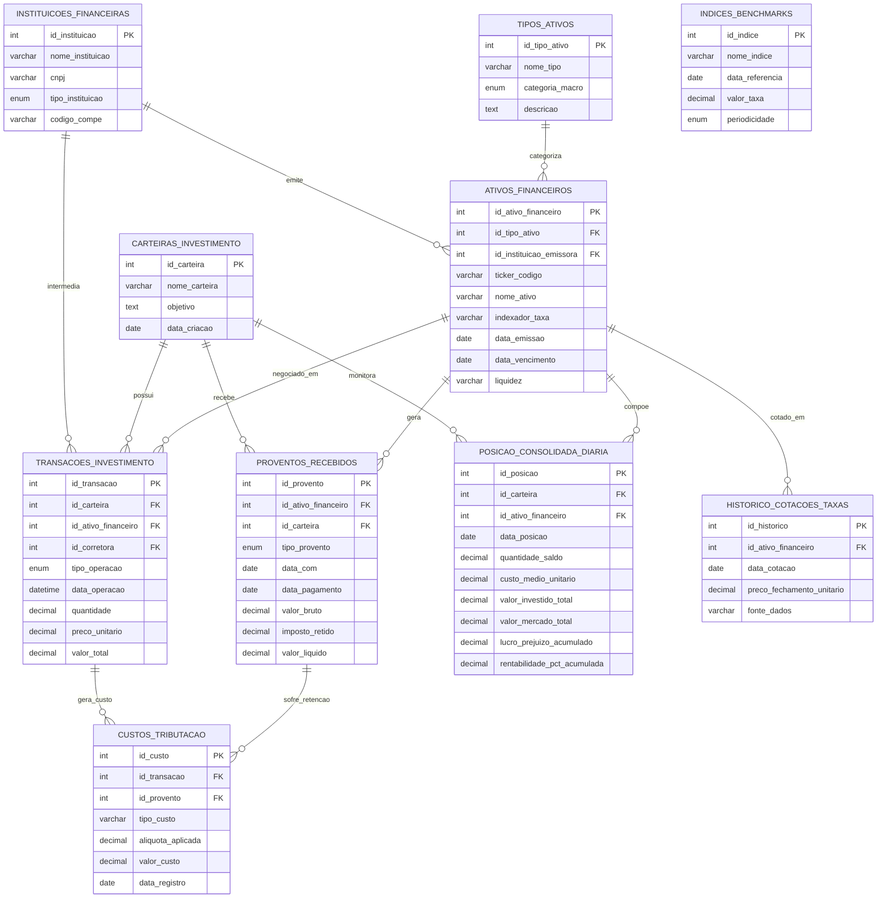

# FinData: Arquitetura de Banco de Dados para Gestão de Ativos Financeiros

## Sobre o Projeto
O FinData é um modelo de banco de dados relacional desenvolvido em MySQL, projetado para o gerenciamento avançado de portfólios de investimentos e estruturação de dados financeiros. O schema foi arquitetado para refletir a complexidade do mercado financeiro, suportando operações de renda fixa e variável, múltiplos prazos de liquidação (ex: D+1, D+2), cálculos de retenção tributária e marcação a mercado de ativos.

A padronização do projeto segue estritamente as convenções de nomenclatura (snake_case) e estabelece rigorosas restrições de integridade referencial.

### Digrama de Entidade-Relacionamento (ER)
O código Mermaid abaixo é renderizado automaticamente pelas plataformas de versionamento (GitHub/GitLab), apresentando a arquitetura relacional e as conexões lógicas entre as entidades do sistema.

   ##  Normalização de Dados (1FN a 4FN)
O banco de dados foi projetado em conformidade com as regras de normalização para evitar redundância e anomalias de transação:

> 1FN: Atributos atômicos e presença de Chaves Primárias exclusivas em todas as tabelas.

>2FN: Eliminação de dependências parciais; atributos não-chave dependem da totalidade da chave primária (ex: tabela de histórico de cotações).

>3FN: Eliminação de dependências transitivas; isolamento de dados de instituições emissoras em tabelas de domínio.

>4FN: Prevenção de dependências multivaloradas; cada tabela gerencia um escopo único e independente de dados.

## Instruções de Execução
Realize o clone deste repositório.

Importe o script FinData_DDL_DML.sql em uma instância do MySQL (utilizando ferramentas como MySQL Workbench, DBeaver ou via CLI).

Execute o código para instanciar o schema gestao_ativos e popular a base com os dados iniciais de homologação.

Consulte a pasta /scripts para acessar as consultas (queries) analíticas prontas para execução.

Consultas Analíticas (Queries)
O projeto inclui scripts SQL avançados, utilizando funções de agregação, agrupamentos e junções complexas, para extração de métricas de negócio, tais como:

Apuração de lucro/prejuízo acumulado e marcação a mercado por carteira de investimento.

Levantamento de proventos líquidos recebidos em períodos contábeis específicos.

Análise de impacto tributário (IRRF, emolumentos B3) sobre as operações executadas.